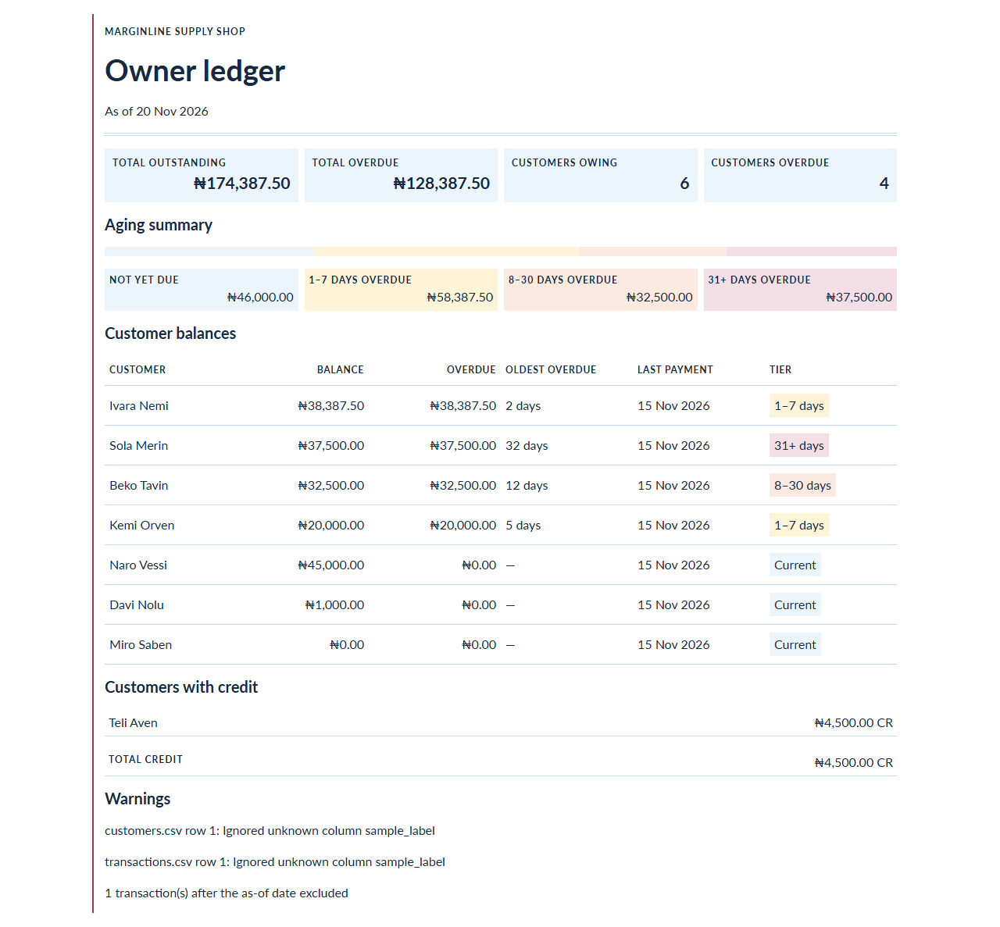
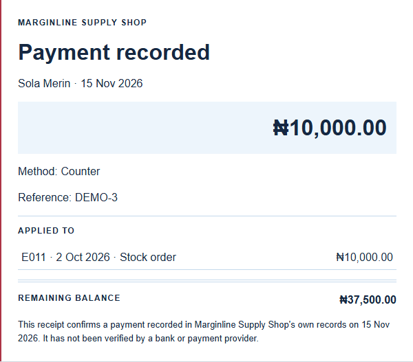
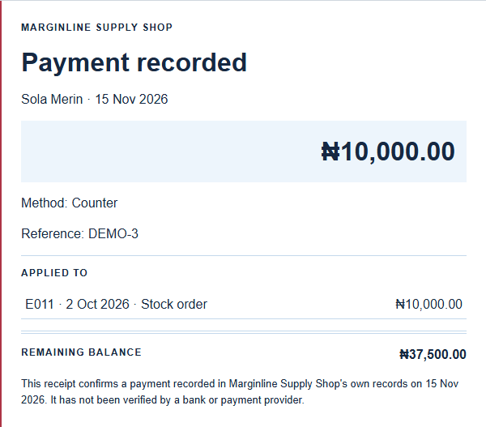

# OweBook

A local TypeScript template kit that turns a small shop's credit sales and payments into four audience-specific outputs: an owner ledger page, a customer statement (PDF), a payment reminder card (image) and a payment receipt (email). Built for the Hyper Elements Template Challenge. All data in this repository is fictional.

Shops that sell on credit need to answer three questions: who owes what, how overdue is it, and what should I send them? OweBook calculates the numbers once, in a tested core, so every output shows the same figures.

## Preview



*Fictional sample data. Owner ledger at 1280 px.*


*Fictional sample data. Owner ledger at 390 px.*


*Fictional sample data. Customer c3’s statement, page 1.*


*Fictional sample data. Square overdue reminder for customer c3.*



*Fictional sample data. Emulated Gmail preview of receipt E015 at 600 px.*


*Fictional sample data. Emulated Gmail preview of receipt E015 at 390 px.*



*Fictional sample data. Emulated Outlook.com preview of receipt E015 at 600 px.*

## Hyper Elements implementation

OweBook uses Hyper Elements React 0.4.6 to render a responsive Page, A4 Document, square Canvas, and Email from the same computed ledger. The templates share one `defineTheme` and expose `PreviewProps` from fictional sample data. Hyper Elements CLI checks the Page, Canvas, and Email, while the Document uses the public `validate` and `renderPdf` APIs.

| Audience | Output | Hyper Elements root | Template |
| --- | --- | --- | --- |
| Shop owner | Responsive ledger | Page | [templates/ledger.tsx](templates/ledger.tsx) |
| Customer | One-page A4 statement | Document | [templates/statement.tsx](templates/statement.tsx) |
| Customer | Square reminder card | Canvas | [templates/reminder.tsx](templates/reminder.tsx) |
| Customer | Payment receipt email | Email | [templates/receipt.tsx](templates/receipt.tsx) |

The Hyper Elements CLI 0.2.10 Document worker fails on a React PDF package export. The public Document APIs run in native Node ESM. Hyper Elements lint 0.1.7 and email-clients 0.4.16 supply HTML diagnostics. [CLI worker details](docs/decisions.md#known-limitations)

## Setup instructions

Install Node.js and npm. The Node-only tier was tested on Windows with Node **24.14.1** and npm **11.18.0**, and in a fresh WSL clone with Node **20.20.2** and npm **10.8.2**. Use `npm.cmd` in PowerShell if execution policy blocks `npm.ps1`.

From the repository root:

```sh
npm ci
npm run build -- --data data/sample --as-of 2026-11-20 --out out/sample
```

| Generated path | Contents |
| --- | --- |
| `out/sample/ledger.html`, `out/sample/ledger.txt` | Owner ledger |
| `out/sample/statements/<customer-id>.pdf` | One-page customer statement |
| `out/sample/reminders/<customer-id>-square.png` | Square reminder for each customer with an overdue balance |
| `out/sample/receipts/<payment-id>.html`, `out/sample/receipts/<payment-id>.txt` | Receipt for each customer’s latest payment, or the selected payment |
| `out/sample/summary.json` | Calculated ledger data in integer minor units |
| `out/sample/evidence/diagnostics.json` | Render and validation diagnostics |

## Input format and ledger rules

OweBook works from shop records in CSV and JSON. Receipts represent payments recorded in the shop’s own data. OweBook does not check bank records, take payments, or send email.

| File | Required fields | Optional fields |
| --- | --- | --- |
| `shop.json` | `name`, `currency.code`, `currency.symbol`, `payment_instructions` | `currency.minorUnits`, `default_terms_days`, `paper`, `contact` |
| `customers.csv` | `id`, `name` | `phone`, `terms_days` |
| `transactions.csv` | `id`, `date`, `customer_id`, `type`, `amount` | `note`, `due_date` on sales, `method` and `reference` on payments |

Provide `--as-of YYYY-MM-DD` for a build or summary.
Add `--payment <id>` to a build to select a single receipt.
Set `shop.paper` to `A4` or omit it to use the default. Letter is rejected, and reminders support square format only.

Enter positive decimal strings with no grouping or currency symbol. Precision must fit the currency's minor units, and the currency symbol can have at most 3 characters. Use the ISO code as the symbol if bundled Lato lacks the glyph. Limits in minor units are 9,999,999,999 per transaction, 99,999,999,999 each for a customer’s absolute balance, credit and overdue amount, and 9,999,999,999,999 each for the shop’s outstanding, overdue and credit totals. Each CSV accepts up to 10,000 data rows.

To write only the summary:

```sh
npm run summary -- --data data/sample --as-of 2026-11-20 --out out/summary.json
```

The calculation excludes interest, fees, refunds, discounts, write-offs, and taxes. [Ledger rules, limits, and capability audit](docs/spec.md) · [Fictional input files](data/sample)

## Currencies

The rendered fixtures cover NGN (₦, 2 decimal places), USD ($, 2 decimal places), and JPY (¥, no decimal places). Each data set uses one currency. The ledger performs no currency conversion.

## Verification

`npm run verify` runs the Node-only tier. It runs 48 named tests, typechecking, contrast checks, builds, CLI checks, and public Document validation for sample, stress-max, stress-min, USD, and JPY.

`npm run verify:full` adds screenshots, Poppler inspection, and the Python cross-check across the five datasets. Install Python 3 and Poppler’s `pdfinfo`, `pdffonts`, `pdftotext`, and `pdftoppm`. On Windows, make Poppler available in the default WSL distribution. Install Playwright Chromium before running the full tier:

```sh
npm exec -- playwright install chromium
npm run verify:full
```

The full tier passed in WSL. See the [named tests](docs/evidence/pre-public-tests.txt), [Node-only run](docs/evidence/pre-public-verify.txt), and [WSL full-tier transcript](docs/evidence/wsl-complete.txt).

The repository includes verification/crosscheck.py, a second implementation of the ledger rules in docs/spec.md written in Python. On the fictional sample dataset (8 customers) and two stress datasets (1 customer each), it reproduces the tool's balances, credits, aging buckets, reminder tiers and payment allocations. It was written by the project team with AI assistance after the sample figures had already been reviewed, so it is a consistency check, not an independent audit.

## Known limitations

The email screenshots are approximations generated by the Hyper Elements email-clients emulator. In these captured Gmail and Outlook.com models, the emulator removed the Lato web-font rules and drew the receipts using Arial. It marked the captures incomplete because its Consolas stand-in was unavailable. The classic Outlook model keeps the 600 px receipt width at a 390 px viewport, which clips the right edge. Informational HTML diagnostics also flag small labels, classic Outlook letter spacing, and fallback fonts. [Emulator findings](docs/evidence/d10b-email-preview-findings.json)

See [security notes](docs/security-notes.md) for the npm audit findings and reachability assessment.

## License

OweBook uses the [MIT license](LICENSE). The bundled fonts have separate [third-party notices](THIRD_PARTY.md).
