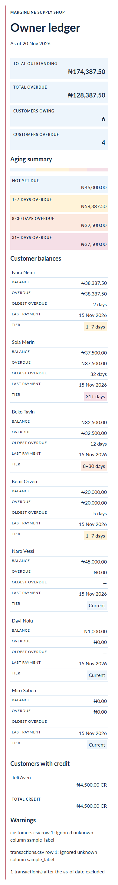
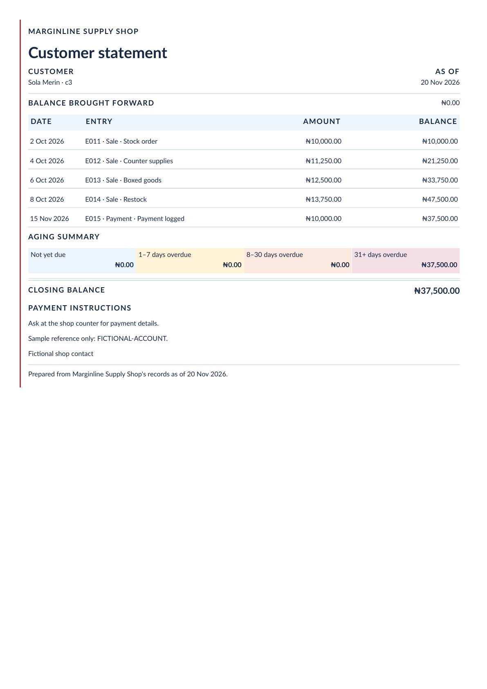
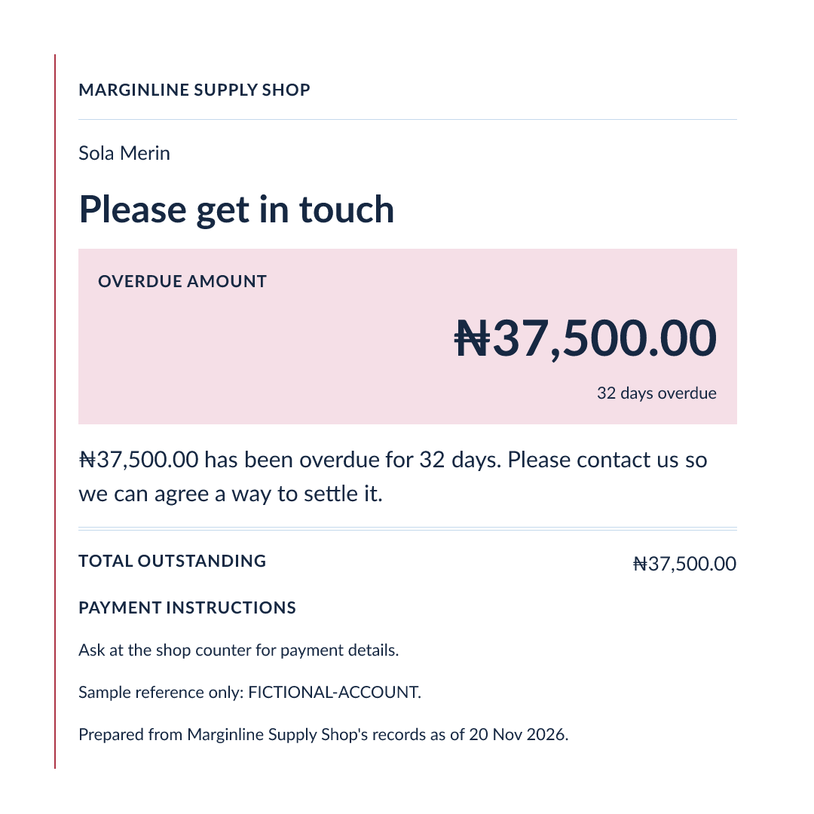
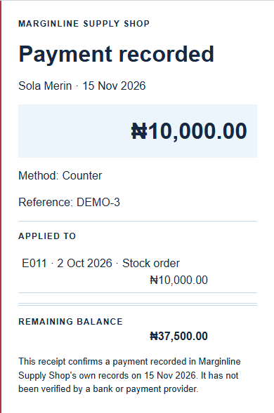

# Preview


*Fictional sample data. Owner ledger at 1280 px.*



*Fictional sample data. Owner ledger at 390 px.*



*Fictional sample data. Customer c3 statement, page 1.*



*Fictional sample data. Square overdue reminder for customer c3.*


*Fictional sample data. Receipt E015, emulated Gmail preview at 600 px.*



*Fictional sample data. Receipt E015, emulated Gmail preview at 390 px.*


*Fictional sample data. Receipt E015, emulated Outlook.com preview at 600 px.*

OweBook is a local TypeScript template kit that turns shop records into a customer statement, payment reminder, payment receipt email, and owner ledger. It has no user accounts, records no payments itself, and sends no email. Receipts describe payments recorded in the shop's own data without checking bank records. The calculation supports one currency per data set and excludes interest, fees, refunds, discounts, write-offs, and taxes. OweBook is a recordkeeping tool and provides no accounting guidance.

# Hyper Elements implementation

Hyper Elements React 0.4.6 supplies the Page, Document, Canvas, and Email roots. They share one `defineTheme` and each template exports `PreviewProps` computed from the fictional sample. The CLI 0.2.10 checks the Page, Canvas, and Email. The CLI Document worker fails on a React PDF package export, so statements use the public Document `validate` and `renderPdf` APIs in native Node ESM. Lint 0.1.7 and email-clients 0.4.16 supply diagnostics for the HTML renders.

# Setup instructions

The Node-only tier passed on Windows Node **24.14.1** with npm **11.18.0** and in a fresh WSL clone on Node **20.20.2** with npm **10.8.2**. Native ESM is enabled in `package.json`. Use `npm.cmd` in PowerShell when its execution policy blocks `npm.ps1`.

From the repository root:

```sh
npm ci
npm run verify
npm run build -- --data data/sample --as-of 2026-11-20 --out out/sample
```

`npm run verify` uses Node only. It runs tests, typechecking, contrast checks, builds, and template checks or Document validation for the sample, both stress sets, USD, and JPY.

`npm run verify:full` adds screenshots, Poppler inspection, and the Python cross-check. Install Python 3 and Poppler's `pdfinfo`, `pdffonts`, `pdftotext`, and `pdftoppm`. On Windows, make Poppler available inside the default WSL distribution. Install Playwright Chromium before running the full tier. The full tier passed in WSL.

```sh
npm exec -- playwright install chromium
npm run verify:full
```

The build reads `shop.json`, `customers.csv`, and `transactions.csv` from the data folder. See [the sample](data/sample) for headers and shop settings, and [the ledger rules](docs/spec.md) for dates, amounts, allocation, credit, and aging. Add `--payment <id>` to choose a receipt. The current scope includes A4 statements and square reminders. See [recorded limitations](docs/decisions.md#known-limitations).

`shop.paper` accepts only `A4` and defaults to `A4` when omitted. Letter is rejected. The reminder card supports square format only. See the [input and command capability audit](docs/spec.md#input-and-command-capability-audit) for fields that are accepted but not displayed.

The CP1 suite covers decimal syntax and limits, CSV parsing, date validation, payment allocation, overpayment and prepayment, aging, currency formatting, and determinism. The verification runner also checks contrast, PDF pagination and embedded fonts, and browser layout.

Enter positive decimal strings with no grouping or currency symbol. The precision must fit the currency's minor units, and the shop's currency symbol can have at most 3 characters. Limits in minor units are 9,999,999,999 per transaction, 99,999,999,999 each for a customer's absolute balance, credit, and overdue amount, and 9,999,999,999,999 each for the shop's outstanding, overdue, and credit totals. Each CSV accepts up to 10,000 data rows.

To write the calculated summary without rendering, run `npm run summary -- --data data/sample --as-of 2026-11-20 --out out/summary.json`.

The symbol must be a character the bundled Lato includes; otherwise use the ISO code as the symbol.

## Currencies

The rendered fixtures cover NGN (₦, two decimal places), USD ($, two decimal places), and JPY (¥, no decimal places). Each data set uses one currency. The ledger performs no currency conversion.

## Known limitations

Informational HTML diagnostics include small labels, classic Outlook letter-spacing differences, and fallback fonts. The full tier's receipt screenshots use Chromium. The Gmail and Outlook.com images above come from the approximate Hyper Elements email-clients emulator. Gmail and Outlook.com removed the Lato web-font rules and used Arial in the captured previews. The emulator marked those previews incomplete because its Consolas stand-in was unavailable. The classic Outlook model keeps the 600 px receipt width at a 390 px viewport, which clips the right edge. Rendering and font choices can vary by email client.

## Tests

The [47 named tests and final Windows results](docs/evidence/d10b-tests.txt) and the [Day 2 fresh WSL clone results](docs/evidence/wsl-complete.txt) are available for review. See the [qualification checklist](docs/qualification-checklist.md) and [evidence for README claims](docs/claims.md).

The repository includes verification/crosscheck.py, a second implementation of the ledger rules in docs/spec.md written in Python. On the fictional sample dataset (8 customers) and two stress datasets (1 customer each), it reproduces the tool's balances, credits, aging buckets, reminder tiers and payment allocations. It was written by the project team with AI assistance after the sample figures had already been reviewed, so it is a consistency check, not an independent audit.

## License

OweBook uses the [MIT license](LICENSE). The bundled fonts have separate [third-party notices](THIRD_PARTY.md).
